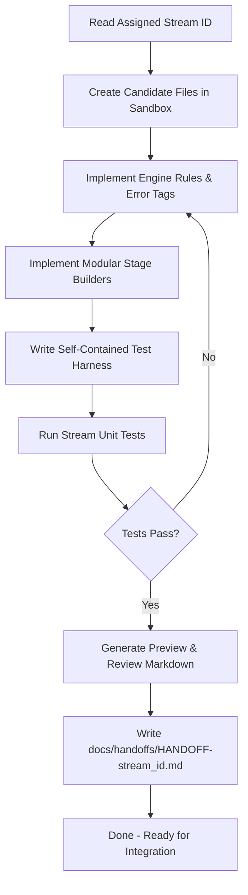
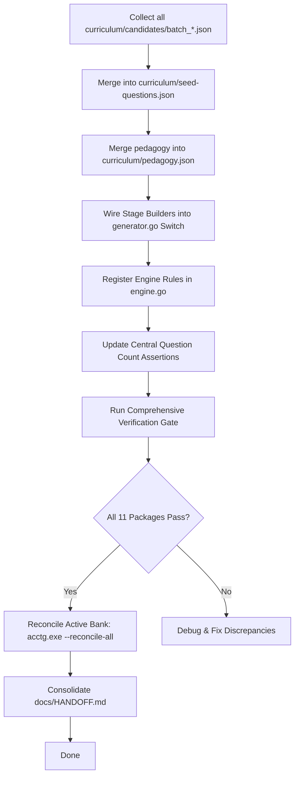

# Multi-Agent Distributed Question Expansion Plan

## 1. Executive Summary & Purpose

This plan establishes a durable, conflict-free framework for running **multiple autonomous coding agents concurrently** to expand the question bank of **AccountTutor 9000** across the University of Washington Foster School of Business *Financial Reporting and Analysis* syllabus (Modules 1–10).

### The Concurrency Problem
When multiple agents work concurrently on a shared repository, standard workflows break down immediately due to:
1. **Central File Collisions:** Concurrent edits to `curriculum/seed-questions.json` and `curriculum/pedagogy.json` produce unresolvable JSON syntax corruptions or Git merge conflicts.
2. **Hardcoded Test Count Collisions:** The test suite enforces strict question count invariants across 5 packages (`validator_test.go`, `pedagogy_test.go`, `expanded_bank_test.go` in `exam`, `mastery`, and `tui`). If two agents independently increment the baseline count from 106 to 110, their branch tests pass in isolation but collide catastrophically upon merge.
3. **Monolithic Switch Statements:** Adding stage builders directly into `internal/drill/generator.go` (3,000+ lines) causes non-contiguous line edit collisions.
4. **Namespace & Domain Duplication:** Uncoordinated agents generate duplicate question IDs, duplicate error tags, or cluster haphazardly in familiar modules (e.g., Module 1 Cash or Module 5 Bad Debt) while neglecting harder syllabus areas (Modules 3, 7, 8, 9, 10).
5. **Handoff Overwrites:** Multiple agents writing status updates to `docs/HANDOFF.md` overwrite each other's audit trails.

### The Solution: Isolated Streams & The Map-Reduce Integration Architecture
This document specifies an **Isolated Stream Protocol** (Map-Reduce model):
- **Parallel Workers (Mappers):** Each agent is assigned an isolated, disjoint **Work Stream** defined by a unique Stream ID, syllabus module cluster, and account category scope. Agents work **exclusively within dedicated, isolated candidate files** without modifying central files or shared test assertions.
- **Isolated Validation Harnesses:** Each stream validates its accounting mechanics, debit/credit balancing, Socratic hinting, and distractor tags using standalone test harnesses that load only the stream's candidate package via `bank.LoadQuestionBankFile`.
- **Integrator Pipeline (Reducer):** A single serial Integrator Agent (or automated pipeline) ingests verified stream candidate packages, merges them into the active question bank, updates central test counters once, executes the full verification gate, and reconciles all entries.

---

## 2. UW Foster Syllabus & Category Dispersion Matrix

To ensure balanced question coverage without domain collisions, work is partitioned across the 10 course modules and 5 financial statement categories.

```
┌──────────────────────────────────────────────────────────────────────────────────┐
│                           10-MODULE COURSE MAP MATRIX                            │
├───────────────┬──────────────────────────────────┬───────────────────────────────┤
│ Module        │ Core Topics                      │ Accounting Categories         │
├───────────────┼──────────────────────────────────┼───────────────────────────────┤
│ Module 1      │ Intro, Equation, Dual Effect     │ Assets, Liabilities, Equity   │
│ Module 2      │ Accrual Cycle, Adjusting Entries │ Deferrals, Accruals, Prepaids │
│ Module 3      │ Cash Flows & Statement Analysis  │ Operating Cash Flows, Ratios  │
│ Module 4      │ Revenue Recognition (ASC 606)    │ Receivables, Advances, Sales  │
│ Module 5      │ Inventory & Cost of Goods Sold   │ Inventory, COGS, NRV/LCM      │
│ Module 6      │ Non-Current Assets & Goodwill    │ PPE, Depreciation, Impairment │
│ Module 7      │ Liabilities & Debt Financing     │ Bonds, Notes, Amortization    │
│ Module 8      │ Leases, Off-Balance Sheet, Equity│ Leases, Repos, Treasury Stock │
│ Module 9      │ Quality of Financial Reporting   │ Policies, Reserve Buffering   │
│ Module 10     │ Statement Analysis & Forecasting │ Disaggregated Drivers, Ratios │
└───────────────┴──────────────────────────────────┴───────────────────────────────┘
```

### Pre-Allocated Work Streams (Batch Allocation)

Each concurrent agent must be assigned exactly **one** stream ID from the table below. No two agents may work on the same stream ID simultaneously.

| Stream ID | Primary Module | Secondary Module | Target Topic & Scenario Description | Account Category Scope | Question ID Namespace | Questions (Standard Batch) | Questions (Full Milestone) |
|---|:---:|:---:|---|---|---|:---:|:---:|
| **Stream-M03** | Mod 3 | Mod 8 | Indirect OCF inventory & payable adjustments; Quick Ratio | Assets, Liabilities, Cash Flow | `q_m03_ocf_*` | 4 | 9 |
| **Stream-M04** | Mod 4 | Mod 2 | ASC 606 Variable consideration; contract asset vs receivable | Assets, Revenue, Liabilities | `q_m04_rev_*` | 4 | 9 |
| **Stream-M05** | Mod 5 | Mod 2 | FIFO vs LIFO perpetual inventory costing; Lower of Cost or NRV | Assets, Cost of Goods Sold | `q_m05_inv_*` | 4 | 9 |
| **Stream-M06** | Mod 6 | Mod 1 | Straight-line vs double declining depreciation; asset disposal | Assets, Depreciation, Equity | `q_m06_ppe_*` | 4 | 9 |
| **Stream-M07** | Mod 7 | Mod 2 | Bond issue at premium; effective interest amortization | Liabilities, Interest Expense | `q_m07_bond_*` | 4 | 10 |
| **Stream-M08** | Mod 8 | Mod 6 | Operating vs Finance lease capitalization; Stock dividend | Liabilities, Right-of-Use Asset | `q_m08_lease_*` | 4 | 9 |
| **Stream-M09** | Mod 9 | Mod 4 | Cookie jar reserve buffering; warranty liability estimates | Liabilities, Operating Expense | `q_m09_qual_*` | 4 | 9 |
| **Stream-M10** | Mod 10 | Mod 3 | DuPont ROE decomposition; working capital turnover drivers | Ratios, Statement Analysis | `q_m10_fore_*` | 4 | 10 |
| **TOTAL** | — | — | **8 Syllabus Streams across Modules 1–10** | — | — | **+32 Questions** | **+74 Questions** |

### Concurrency Guardrail: Maximum 3 Agents Running Concurrently

To avoid workstation resource exhaustion, terminal window crowding, and excessive provider rate limits, **at most 3 agents may run simultaneously at any time**.

Work is scheduled using the **3-Agent Wave Protocol**:

```
                         MAX 3 CONCURRENT AGENTS SCHEDULE
  
  ┌────────────────────────────────────────────────────────────────────────┐
  │ WAVE 1 (3 Agents Max): Operating Cycles & Working Capital              │
  │ • Agent 1: Stream-M03 (Cash Flows & Financial Statements)  ──> +4 Qs   │
  │ • Agent 2: Stream-M04 (Revenue Recognition / ASC 606)     ──> +4 Qs   │
  │ • Agent 3: Stream-M05 (Inventory & Cost of Goods Sold)    ──> +4 Qs   │
  │ [Wave 1 Yield: +12 Questions | Bank: 106 ➔ 118]                        │
  └───────────────────────────────────┬────────────────────────────────────┘
                                      │ Integrator merges & reconciles Wave 1
                                      ▼
  ┌────────────────────────────────────────────────────────────────────────┐
  │ WAVE 2 (3 Agents Max): Non-Current Assets, Debt & Leases               │
  │ • Agent 1: Stream-M06 (PPE, Depreciation, Impairments)    ──> +4 Qs   │
  │ • Agent 2: Stream-M07 (Liabilities, Bonds & Amortization) ──> +4 Qs   │
  │ • Agent 3: Stream-M08 (Leases, Repos & Treasury Stock)    ──> +4 Qs   │
  │ [Wave 2 Yield: +12 Questions | Bank: 118 ➔ 130]                        │
  └───────────────────────────────────┬────────────────────────────────────┘
                                      │ Integrator merges & reconciles Wave 2
                                      ▼
  ┌────────────────────────────────────────────────────────────────────────┐
  │ WAVE 3 (2 Agents Max): Reporting Quality & Financial Forecasting       │
  │ • Agent 1: Stream-M09 (Quality of Financial Reporting)    ──> +4 Qs   │
  │ • Agent 2: Stream-M10 (Financial Statement Forecasting)   ──> +4 Qs   │
  │ [Wave 3 Yield: +8 Questions | Bank: 130 ➔ 138]                         │
  └────────────────────────────────────────────────────────────────────────┘
```

### Scope Scenarios Under the 3-Agent Cap

Depending on how many waves you choose to execute:

1. **Immediate Single Wave (Running 3 agents right now):**
   - **Active Agents:** Exactly 3 agents (Stream-M03, Stream-M04, Stream-M05).
   - **New Questions Added:** **+12 questions** (3 agents $\times$ 4 questions).
   - **Bank Trajectory:** **106 $\rightarrow$ 118 active questions** (119 templates).

2. **Full Multi-Wave Cycle (All 3 sequential waves, 3 agents max at any time):**
   - **Active Agents:** 3 in Wave 1, 3 in Wave 2, 2 in Wave 3.
   - **New Questions Added:** **+32 questions** across the entire 10-module syllabus.
   - **Bank Trajectory:** **106 $\rightarrow$ 138 active questions** (139 templates).

3. **Full 180 Milestone Goal (Running 2 cycles of the 3 waves):**
   - **New Questions Added:** **+74 questions** ($\approx$ 9–10 questions per stream).
   - **Bank Trajectory:** **106 $\rightarrow$ 180 active questions** (181 templates).

---

## 3. Zero-Contention File Isolation Protocol

### Read-Only Files for Stream Agents (Strictly Forbidden to Edit)
Stream agents working concurrently **MUST NOT EDIT** any of the following files:
```
[DO NOT EDIT IN PARALLEL]
├── curriculum/seed-questions.json          <-- Monolithic active bank
├── curriculum/pedagogy.json                <-- Monolithic pedagogy policy
├── curriculum/accounts.json                <-- Central account catalog (unless pre-coordinated)
├── internal/drill/generator.go             <-- Monolithic stage builder switch
├── internal/bank/validator_test.go         <-- Hardcoded question count assertions
├── internal/bank/pedagogy_test.go          <-- Hardcoded pedagogy count assertions
├── internal/exam/expanded_bank_test.go     <-- Hardcoded exam item assertions
├── internal/mastery/expanded_bank_test.go  <-- Hardcoded mastery attempt assertions
├── internal/tui/expanded_bank_test.go      <-- Hardcoded TUI bank assertions
├── internal/tui/expanded_context_test.go   <-- Hardcoded TUI context assertions
└── docs/HANDOFF.md                         <-- Shared handoff log
```

### Dedicated File Sandboxes (Created and Owned per Stream)
Each stream agent creates and operates within its own dedicated set of files, named strictly with the agent's `StreamID` (e.g., `m05`):

```
acctg-practice/
├── curriculum/
│   └── candidates/
│       ├── batch_<stream_id>.json            <-- Question templates for this stream
│       └── pedagogy_<stream_id>.json         <-- Pedagogical policies & settings
├── internal/
│   ├── drill/
│   │   ├── stages_<stream_id>.go             <-- Modular stage builders
│   │   └── syllabus_<stream_id>_test.go      <-- Self-contained unit tests
│   └── engine/
│       ├── rules_<stream_id>.go              <-- Modular engine rules
│       └── event_<stream_id>.go              <-- Error tags & event constants
└── docs/
    ├── streams/
    │   ├── STREAM-<stream_id>-PREVIEW.md     <-- Rendered stage review
    │   └── STREAM-<stream_id>-REVIEW.md      <-- Accounting & pedagogical review
    └── handoffs/
        └── HANDOFF-<stream_id>.md            <-- Stream execution report
```

Because every filename contains `<stream_id>`, **no two agents touch the same file**. Git merges are guaranteed to be clean and conflict-free.

---

## 4. Symbol & Namespace Naming Rules

To avoid Go compilation collisions and database ID collisions, all identifiers must follow strict namespacing rules:

### 1. Question IDs
- **Syntax:** `q_<stream_id>_<topic>_<variant>`
- **Example:** `q_m05_inventory_fifo_costing_01`
- **Constraint:** Lowercase alphanumeric characters and underscores only.

### 2. Error Tags & Misconceptions
- **Syntax:** `Tag<StreamPascalCase><Misconception>`
- **Example:** `TagM05LifoUsedInIFRS`, `TagM07PremiumRecordedAsGain`
- **Location:** Defined in `internal/engine/event_<stream_id>.go`.

### 3. Engine Rules & Event Families
- **Family ID:** `Family<StreamPascalCase><Topic>` (e.g., `FamilyM05InventoryFIFO`)
- **Rule Struct:** `type <StreamPascalCase><Topic>Rule struct{}` (e.g., `type M05InventoryFIFORule struct{}`)
- **Location:** Implemented in `internal/engine/rules_<stream_id>.go`.

### 4. Drill Stage Builders
- **Syntax:** `func build<StreamPascalCase><Topic>Stages(q *bank.Question, seed int64) []Stage`
- **Location:** Defined in `internal/drill/stages_<stream_id>.go`.

---

## 5. Candidate Specification & Pedagogical Invariants

Every question generated within `curriculum/candidates/batch_<stream_id>.json` must comply with [docs/AGENT-CONTRACT.md](AGENT-CONTRACT.md) and [docs/PEDAGOGY.md](PEDAGOGY.md):

### Mandatory Invariants
1. **Integer Minor Units:** All financial values are expressed in cents (e.g., `$50.00` is encoded as `5000`).
2. **Double-Entry Balance:** For every transaction instance:
   $$\sum \text{Debits} == \sum \text{Credits}$$
3. **Derived Equation Balance:** The fundamental balance sheet equation effect must hold identically:
   $$\Delta \text{Assets} == \Delta \text{Liabilities} + \Delta \text{Equity}$$
4. **Socratic Hint Invariant:** Every `CausalHint` must:
   - Guide the student with a causal question rather than stating the answer.
   - **End with a question mark (`?`).**
   - Never reveal the target account name prematurely.
5. **Stage 1 Neutrality:** Explanations for Stage 1 (`IdentifyAccount`) **MUST NOT** include the words `"debit"` or `"credit"`, as the account classification step precedes side assignment.
6. **Triple Parameter Permutations:** Each template must define at least 3 distinct allowed amounts (e.g., `[5000, 10000, 25000]`) to ensure replay variety.

---

## 6. Worker Agent Workflow (The "Mapper" Phase)

Each worker agent follows this exact sequence from start to finish:



### Step 6.1: Initialize Stream Files
Create the directory structure if it does not already exist:
```powershell
New-Item -ItemType Directory -Force curriculum/candidates
New-Item -ItemType Directory -Force docs/streams
New-Item -ItemType Directory -Force docs/handoffs
```

### Step 6.2: Draft Candidate Questions (`curriculum/candidates/batch_<stream_id>.json`)
Structure the JSON file following the canonical `bank.QuestionBankFile` schema:
```json
{
  "version": 1,
  "questions": [
    {
      "id": "q_m05_inventory_fifo_costing_01",
      "family_id": "m05_inventory_fifo",
      "rule_version": 1,
      "status": "candidate_pending_review",
      "scenario_template": "Sold 100 units of merchandise under FIFO costing for {{.Amount}} cash.",
      "parameters": {
        "amount": [5000, 10000, 20000]
      },
      "concepts": ["inventory", "cogs", "fifo"],
      "expected_fixture": { ... }
    }
  ]
}
```

### Step 6.3: Implement Rules & Error Tags
In `internal/engine/event_<stream_id>.go`:
```go
package engine

const (
    TagM05LifoUsedInIFRS Tag = "m05_lifo_used_in_ifrs"
)
```

In `internal/engine/rules_<stream_id>.go`:
```go
package engine

import "github.com/trustdan/acctg-practice/internal/domain"

type M05InventoryFIFORule struct{}

func (r *M05InventoryFIFORule) Evaluate(txn *domain.Transaction) EvaluationResult {
    // Deterministic evaluation logic
}
```

### Step 6.4: Implement Modular Stage Builders
In `internal/drill/stages_<stream_id>.go`:
```go
package drill

import "github.com/trustdan/acctg-practice/internal/bank"

func buildM05InventoryFIFOStages(q *bank.Question, seed int64) []Stage {
    // Returns 7 ordered scaffolding stages with Socratic hints ending in '?'
}
```

### Step 6.5: Implement Standalone Unit Test
In `internal/drill/syllabus_<stream_id>_test.go`:
```go
package drill_test

import (
    "testing"
    "github.com/trustdan/acctg-practice/internal/bank"
    "github.com/trustdan/acctg-practice/internal/domain"
)

func TestStreamM05Questions(t *testing.T) {
    catalog := domain.NewDefaultAccountCatalog()
    batchPath := "../../curriculum/candidates/batch_m05.json"
    
    pack, err := bank.LoadQuestionBankFile(batchPath, catalog)
    if err != nil {
        t.Fatalf("failed to load stream batch: %v", err)
    }
    
    // Validate balancing, equation reconciliation, and hint formatting
    for _, q := range pack.Questions {
        // Assert all invariants
    }
}
```

### Step 6.6: Execute Stream Verification Command
The agent runs its isolated test suite without running global count tests:
```powershell
go test -v ./internal/drill -run TestStreamM05
go vet ./...
```

### Step 6.7: Generate Stream Documentation
1. Output rendered preview to `docs/streams/STREAM-<stream_id>-PREVIEW.md`.
2. Output accounting/pedagogy review to `docs/streams/STREAM-<stream_id>-REVIEW.md`.
3. Output completion report to `docs/handoffs/HANDOFF-<stream_id>.md`.

---

## 7. Integrator Agent Workflow (The "Reducer" Phase)

Once all worker agents have completed their streams, a **single Integrator Agent** (or automated pipeline) merges the verified packages into the master active bank.



### Step 7.1: Batch Ingestion & JSON Merging
The integrator reads each candidate file from `curriculum/candidates/` and appends the validated questions to `curriculum/seed-questions.json`.
- Changes status from `"candidate_pending_review"` to `"approved_active"`.
- Records review metadata with timestamp and reviewer identity.

### Step 7.2: Wire Central Dispatchers
1. In `internal/drill/generator.go`, add dispatch branches for the new family IDs to call the modular `build<Stream>Stages` functions.
2. In `internal/engine/engine.go`, register the new rules from `rules_<stream_id>.go`.

### Step 7.3: Synchronize Central Test Counters
The integrator updates the count assertions across the test suite:
- Total active questions: $N_{\text{new}} = N_{\text{old}} + \sum \Delta K_i$
- Total templates: $N_{\text{new}} + 1$ (including retired)
- Total exam items: $2 \times N_{\text{new}}$
- Total mastery attempts: $7 \times N_{\text{new}}$
- Total scenario checks: $3 \times N_{\text{new}}$
- Total context variants: $9 \times N_{\text{new}}$

Files updated:
1. `internal/bank/validator_test.go`
2. `internal/bank/pedagogy_test.go`
3. `internal/exam/expanded_bank_test.go`
4. `internal/mastery/expanded_bank_test.go`
5. `internal/tui/expanded_bank_test.go`
6. `internal/tui/expanded_context_test.go`

### Step 7.4: Execute Final Verification Gate
The integrator executes the complete project gate:
```powershell
go test ./...
go vet ./...
go build -o acctg.exe ./cmd/acctg
.\acctg.exe --reconcile-all --db :memory:
```

### Step 7.5: Consolidate Master Handoff
The integrator rolls up all individual stream handoffs (`docs/handoffs/HANDOFF-*.md`) into a clean summary at the top of `docs/HANDOFF.md`.

---

## 8. Multi-Agent Launch Prompts & Checklist

When spawning parallel worker agents, provide each agent with the following prompt template:

### Worker Agent Launch Prompt Template
```markdown
You are an autonomous accounting curriculum agent assigned to:
STREAM ID: [Insert e.g. Stream-M05]
MODULE SCOPE: [Insert e.g. Module 5 Inventory & COGS]
QUESTION ID PREFIX: [Insert e.g. q_m05_inv_]

STRICT ISOLATION CONTRACT:
1. You MUST read docs/MULTI-AGENT-QUESTION-EXPANSION-PLAN.md before beginning.
2. DO NOT edit curriculum/seed-questions.json, curriculum/pedagogy.json, or docs/HANDOFF.md.
3. DO NOT edit internal/drill/generator.go or any expanded_bank_test.go files.
4. Confine ALL your edits to your isolated stream files:
   - curriculum/candidates/batch_[stream_id].json
   - curriculum/candidates/pedagogy_[stream_id].json
   - internal/drill/stages_[stream_id].go
   - internal/drill/syllabus_[stream_id]_test.go
   - internal/engine/rules_[stream_id].go
   - internal/engine/event_[stream_id].go
   - docs/streams/STREAM-[stream_id]-PREVIEW.md
   - docs/streams/STREAM-[stream_id]-REVIEW.md
   - docs/handoffs/HANDOFF-[stream_id].md
5. Ensure all entries balance to the penny (Debits == Credits).
6. Ensure all CausalHints end in '?' and Stage 1 explanations omit 'debit'/'credit'.
7. Run and pass: go test -v ./internal/drill -run TestStream[StreamID].
```

### Ready-to-Run Wave 1 Launch Prompts (3 Agents Max)

#### Agent 1 (Stream-M03: Cash Flows & Financial Statements)
```markdown
You are Worker Agent 1 executing Wave 1 of docs/MULTI-AGENT-QUESTION-EXPANSION-PLAN.md.
Assigned Stream: Stream-M03 (Module 3: Cash Flows & Financial Statements).
Scope: 4 new questions (q_m03_ocf_*) covering indirect operating cash flow adjustments (working capital changes, inventory/payables adjustments) and liquidity ratios (Quick Ratio).
Follow the strict isolation contract: write only to curriculum/candidates/batch_m03.json, curriculum/candidates/pedagogy_m03.json, internal/drill/stages_m03.go, internal/drill/syllabus_m03_test.go, internal/engine/rules_m03.go, internal/engine/event_m03.go, docs/streams/STREAM-m03-*.md, and docs/handoffs/HANDOFF-m03.md. Do NOT touch any shared or test count files.
```

#### Agent 2 (Stream-M04: Revenue Recognition ASC 606)
```markdown
You are Worker Agent 2 executing Wave 1 of docs/MULTI-AGENT-QUESTION-EXPANSION-PLAN.md.
Assigned Stream: Stream-M04 (Module 4: Revenue Recognition ASC 606).
Scope: 4 new questions (q_m04_rev_*) covering variable consideration, contract asset vs. accounts receivable, and right of return accounting.
Follow the strict isolation contract: write only to curriculum/candidates/batch_m04.json, curriculum/candidates/pedagogy_m04.json, internal/drill/stages_m04.go, internal/drill/syllabus_m04_test.go, internal/engine/rules_m04.go, internal/engine/event_m04.go, docs/streams/STREAM-m04-*.md, and docs/handoffs/HANDOFF-m04.md. Do NOT touch any shared or test count files.
```

#### Agent 3 (Stream-M05: Inventory & Cost of Goods Sold)
```markdown
You are Worker Agent 3 executing Wave 1 of docs/MULTI-AGENT-QUESTION-EXPANSION-PLAN.md.
Assigned Stream: Stream-M05 (Module 5: Inventory & Cost of Goods Sold).
Scope: 4 new questions (q_m05_inv_*) covering perpetual FIFO vs. LIFO costing differences, lower of cost or net realizable value (NRV) write-down, and freight-in inventory capitalization.
Follow the strict isolation contract: write only to curriculum/candidates/batch_m05.json, curriculum/candidates/pedagogy_m05.json, internal/drill/stages_m05.go, internal/drill/syllabus_m05_test.go, internal/engine/rules_m05.go, internal/engine/event_m05.go, docs/streams/STREAM-m05-*.md, and docs/handoffs/HANDOFF-m05.md. Do NOT touch any shared or test count files.
```


---

## 9. Conflict Prevention Verification Matrix

| Potential Collision Vector | Prevention Mechanism | Enforced By |
|---|---|---|
| Concurrent git merge conflicts in JSON files | Dedicated candidate files in `curriculum/candidates/` | Architecture |
| Conflicting global question count assertions | Standalone test files loading candidate JSON only | Isolated test harness |
| Giant generator switch merge conflicts | Stage builders in separate files (`stages_<stream_id>.go`) | Go package modularity |
| Duplicate question IDs | Strict prefixing: `q_<stream_id>_<topic>_<variant>` | Naming rules |
| Duplicate error tags | Strict prefixing: `Tag<StreamPascalCase>...` | Naming rules |
| Simultaneous overwrites of `docs/HANDOFF.md` | Stream-specific handoffs in `docs/handoffs/` | Handoff architecture |
| Broken global builds during drafting | Candidates not compiled into central binary until reducer | Reducer pipeline |
| Unbalanced or inaccurate accounting | Automated table-driven tests & `./acctg.exe --reconcile-all` | Reconciler gate |
